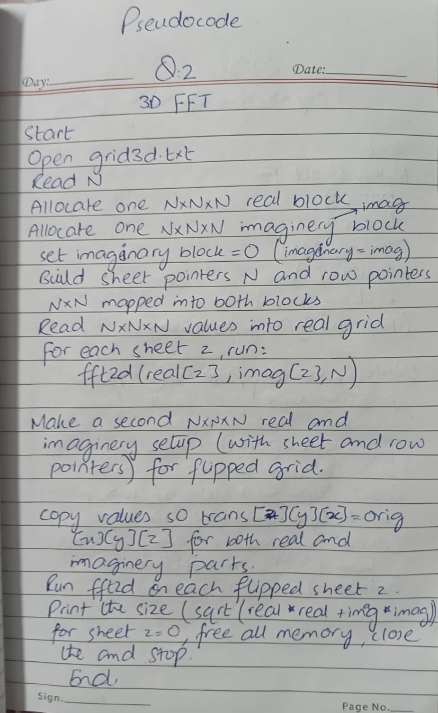

# Question 2

Topic: 3D Fast Fourier Transform (FFT)

Topics: Pointers & Pointer Mapping, Multi-Dimensional Dynamic Allocation, Fast Fourier Transform (FFT), Matrix Transposition, File I/O.

## Pseudocode

